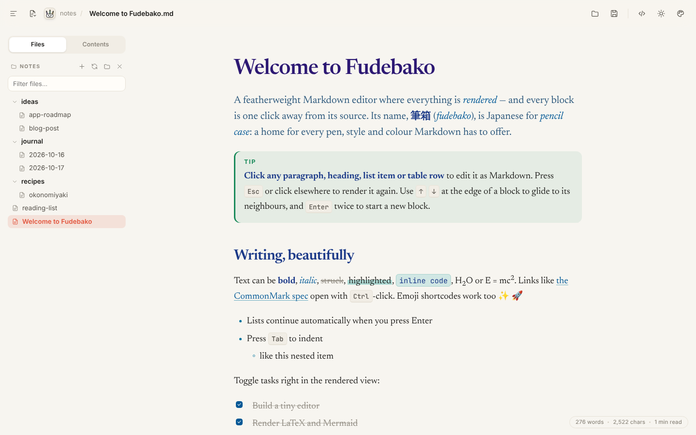
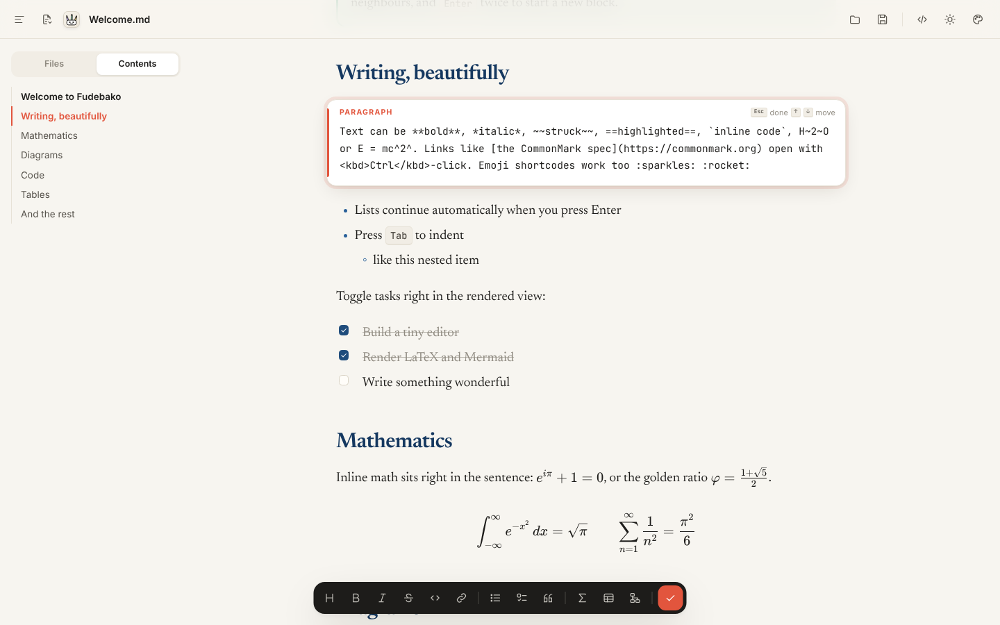
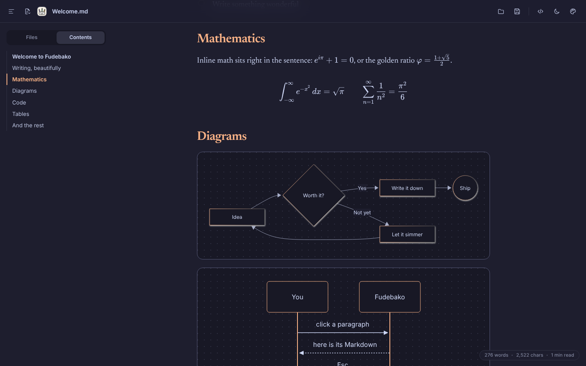
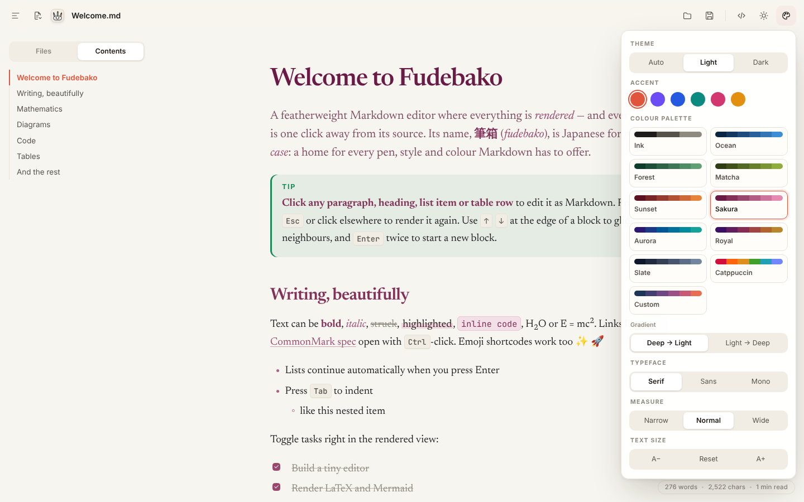
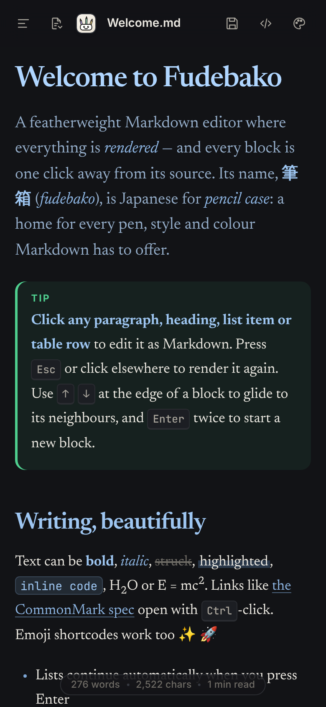

<div align="center">


# Fudebako

**A featherweight Markdown editor where everything is rendered, and every block is one click away from its source.** 

*筆箱 (fudebako): Japanese for “pencil case”, a home for every pen, style and colour Markdown has to offer.*

[](https://github.com/bl8mingdev/fudebako/releases/latest)
[](https://github.com/bl8mingdev/fudebako/actions/workflows/build.yml)
[](LICENSE)




</div>

---

## Why Fudebako?

Most Markdown editors make you choose between a split screen of raw text and preview, or a "what you see is what you get" editor that hides the Markdown from you. Fudebako does neither: **the whole document is always rendered**, and **clicking any paragraph, heading, list item or table row turns that one block back into Markdown**. Edit it, press `Esc` or click elsewhere, and it's rendered again.

- ✍️ **Click-to-edit blocks**: write in Markdown, read in beautiful typography, with no split screen.
- 🧮 **LaTeX and Mermaid built in**: equations with KaTeX and flowcharts, sequence diagrams and more with Mermaid, previewed live while you type.
- 🎨 **Colour palettes**: headings shade from deep (H1) to light (H6), and bold, links, code and quotes follow the same scale. Choose from a selection of 10 palettes, or make your own.
- 📁 **Folder workspace**: open a folder of notes and switch between files from the sidebar, with filtering and auto-save on switch.
- 🪶 **Truly lightweight**: the core is about 180 KB, and the installers are a only a few MB.
- 🌐 **Works (almost) everywhere**: Windows, Linux, Android
- 🔓 **Free and open source**: MIT licensed, with no account, tracking or telemetry. Your files stay plain `.md` files on your disk.

<table>
  <tr>
    <td width="50%"></td>
    <td width="50%"></td>
  </tr>
  <tr>
    <td align="center"><sub>Click a block to edit it as Markdown</sub></td>
    <td align="center"><sub>Dark mode with Catppuccin Mocha, LaTeX and Mermaid</sub></td>
  </tr>
  <tr>
    <td width="50%"></td>
    <td width="50%" align="center"></td>
  </tr>
  <tr>
    <td align="center"><sub>Themes, accents, palettes, typefaces and measures</sub></td>
    <td align="center"><sub>Made for small screens too</sub></td>
  </tr>
</table>

### Supported Markdown

GitHub-flavoured Markdown (tables, task lists you can tick in the rendered view, strikethrough, autolinks), footnotes, **LaTeX** (`$…$`, `$$…$$`, ```` ```math ````), **Mermaid** diagrams, syntax highlighting for code blocks, GitHub alerts (`> [!NOTE]`, `> [!TIP]`, `> [!WARNING]`…), `==highlight==`, `H~2~O` / `x^2^`, definition lists, emoji shortcodes (`:rocket:`), YAML front matter and raw HTML.

## Installation

Download the file for your system from the **[latest release](https://github.com/bl8mingdev/fudebako/releases/latest)**.

| System | File | How to install |
|---|---|---|
| **Windows 10 / 11** | `Fudebako_x.y.z_x64-setup.exe` | Run it. No admin rights needed. It adds **Edit with Fudebako** to the right-click menu of Markdown files. |
| **Debian / Ubuntu** | `Fudebako_x.y.z_amd64.deb` | `sudo apt install ./Fudebako_x.y.z_amd64.deb` |
| **Fedora / openSUSE** | `Fudebako-x.y.z-1.x86_64.rpm` | `sudo dnf install ./Fudebako-x.y.z-1.x86_64.rpm` |
| **Any Linux** | `Fudebako_x.y.z_amd64.AppImage` | `chmod +x Fudebako_*.AppImage`, then run it. |
| **Android** | `Fudebako_x.y.z_android.apk` | Open it on the phone and allow *Install unknown apps* when asked. |

> [!NOTE]
> The Windows installer isn't code-signed yet, so Windows SmartScreen may say *“Windows protected your PC”*. Click **More info → Run anyway**. The Android APK is in early testing: opening and saving single files works, but the folder workspace isn't supported yet.

**Prefer a browser?** Fudebako also runs as a web app. Build it with `npm run build`, host the `dist/` folder over HTTPS, then open it in Chrome or Edge and choose **Install** (or **Add to Home screen** on Android). It works offline afterwards.

## Using Fudebako

- **Edit**: click any block to edit it as Markdown. `Esc` or a click elsewhere renders it again. `↑` / `↓` at the edge of a block move to the neighbouring block, and `Enter` twice starts a new block. Lists continue automatically, and `Tab` indents.
- **Format**: while editing, a toolbar at the bottom offers headings, bold, italic, code, links, lists, tasks, quotes, math, tables and diagrams.
- **Files**: the **File menu** (top left) has *New*, *Open*, *Save*, *Save as*, *Open folder*, *Export HTML* and *Print / PDF*. You can also drag and drop a `.md` file onto the window.
- **Folders**: *Open folder* lists every Markdown file in the sidebar. Click a file to switch to it (the current file is saved first), `＋` creates a new note, and the folder reopens at the next launch.
- **Appearance**: the palette button (top right) sets theme (auto / light / dark), accent colour, colour palette and its direction, typeface (serif / sans / mono), line width and text size.
- **Source mode**: `Ctrl+/` shows the whole raw Markdown file when you need it.
- **Safety net**: a draft is saved locally as you type, so nothing is lost if the app closes. `Ctrl+S` writes the real file.

| Shortcut | Action |
|---|---|
| `Ctrl+O` / `Ctrl+Shift+O` | Open a file / a folder |
| `Ctrl+S` / `Ctrl+Shift+S` | Save / Save as |
| `Ctrl+Alt+N` | New document |
| `Ctrl+B` `Ctrl+I` `Ctrl+E` `Ctrl+K` | Bold, italic, inline code, link |
| `Ctrl+/` | Toggle source mode |
| `Ctrl+\` | Toggle the sidebar |
| `Ctrl+Z` / `Ctrl+Y` | Undo / Redo |
| `Ctrl+P` | Print or save as PDF |
| `Ctrl+Click` | Follow a link |

The full list is in **File menu → Shortcuts**, and **File menu → Feature tour** opens a sample document showing everything Fudebako can render.

## Licence

Fudebako is free and open-source software released under the **[MIT License](LICENSE)**, © 2026 Bl∞ming. You can use, copy, modify and redistribute it, including commercially, as long as the copyright notice and licence text are kept.

The third-party libraries bundled in the app keep their own (permissive) licences, listed in **[THIRD-PARTY-NOTICES.md](THIRD-PARTY-NOTICES.md)** and in the app under **File menu → About**. The fonts used are Newsreader and JetBrains Mono, both under the SIL Open Font License 1.1.

---

## How it's built

| Layer | Technology |
|---|---|
| User interface | Vanilla JavaScript and CSS, no framework, bundled with [Vite](https://vite.dev) |
| Markdown | [markdown-it](https://github.com/markdown-it/markdown-it) and plugins (footnotes, mark, sub/sup, definition lists, emoji) plus Fudebako's own (math, alerts, task lists, front matter, source-line mapping) |
| Math / diagrams / code | [KaTeX](https://katex.org), [Mermaid](https://mermaid.js.org), [highlight.js](https://highlightjs.org), each loaded on demand only when a document needs it |
| Desktop and Android | [Tauri 2](https://tauri.app) (Rust), using WebView2 on Windows, WebKitGTK on Linux and the system WebView on Android |
| Web | Progressive Web App with a service worker and the File System Access API |

### Project layout

```
index.html              app shell
src/main.js             block editor, UI, menus, file and folder actions
src/markdown.js         markdown-it setup and custom plugins
src/hydrate.js          lazy KaTeX / Mermaid / highlight.js with caching
src/fileio.js           open/save: Tauri dialogs, File System Access API, or download fallback
src/folder.js           folder workspace (scan, tree, persistence)
src/palettes.js         colour palettes, including Catppuccin
src/brand.js            app name, author and tagline in one place
src/styles/             app chrome (app.css) and document typography (content.css)
public/                 PWA manifest, service worker, icons
src-tauri/              native shell: Rust code, Tauri config, installer hooks, icons
scripts/                build guards, licence notices, Windows context-menu script
.github/workflows/      CI that builds and publishes releases
docs/screenshots/       images used in this README
```

### How click-to-edit works

A small markdown-it rule stamps every block-level element with `data-ln="start-end"`, its line range in the source file. Clicking an element opens a textarea over exactly those lines, with the caret placed where you clicked. Every keystroke is written back into the source, and on leaving the block the document is re-rendered from cache, so equations and diagrams don't flicker.

## Building it yourself

### Prerequisites

- **[Node.js](https://nodejs.org) 20 or newer**, for every target.
- **[Rust](https://rustup.rs)**, for the native apps (Windows, Linux, Android).
- **Windows**: *Microsoft C++ Build Tools* with the “Desktop development with C++” workload. WebView2 is already part of Windows 10 and 11.
- **Linux (Debian/Ubuntu)**:
  ```bash
  sudo apt install libwebkit2gtk-4.1-dev librsvg2-dev libappindicator3-dev patchelf
  ```
- **Android**: Android Studio with the SDK, *NDK (Side by side)* and command-line tools; JDK 17 (Android Studio's bundled `jbr` works); the variables `JAVA_HOME`, `ANDROID_HOME` and `NDK_HOME`; and the Rust targets:
  ```bash
  rustup target add aarch64-linux-android armv7-linux-androideabi x86_64-linux-android i686-linux-android
  ```
  On Windows, also turn on **Developer Mode** (the Android build creates symbolic links).

### Commands

```bash
git clone https://github.com/bl8mingdev/fudebako.git
cd fudebako
npm install
```

| Goal | Command | Output |
|---|---|---|
| Develop in the browser | `npm run dev` | http://localhost:5173 with hot reload |
| Develop the desktop app | `npm run app:dev` | Native window with hot reload |
| Web / PWA build | `npm run build` | Static site in `dist/` (host it over HTTPS) |
| Windows / Linux packages | `npm run app:build` | `src-tauri/target/release/bundle/` (`nsis/`, `deb/`, `rpm/`, `appimage/`) |
| Android project (once) | `npm run android:init` | `src-tauri/gen/android/` |
| Android APK | `npx tauri android build --apk --debug` | `src-tauri/gen/android/app/build/outputs/apk/` |
| Android on a device | `npm run android:dev` | Runs on a USB-connected phone or an emulator |
| Licence notices | `npm run notices` | Regenerates `THIRD-PARTY-NOTICES.md` |

Native packages are built for the system you're on: build the Windows installer on Windows and the Linux packages on Linux. `--debug` signs the APK with a development key so it can be installed directly.

### Windows right-click menu for self-built executables

The installer registers **Edit with Fudebako** automatically. If you run a self-built or portable `fudebako.exe`, register it yourself:

```powershell
powershell -ExecutionPolicy Bypass -File scripts\context-menu.ps1 -Exe "C:\path\to\fudebako.exe"
powershell -ExecutionPolicy Bypass -File scripts\context-menu.ps1 -Remove
```

### Icons

`public/icon.svg` is the full-detail logo used for large sizes. `public/icon-small.svg` is a bolder drawing (thicker lines, bigger eyes and ω mouth) hand-tuned for 16–89 px: the favicon, the title bar, the small frames of `icon.ico` and the small Windows and Android launcher icons. Running `tauri icon` regenerates every size from one image, so re-export the small sizes from `icon-small.svg` afterwards.

### Automatic releases

Every push to the `release` branch runs [`.github/workflows/build.yml`](.github/workflows/build.yml) on GitHub Actions. It builds the Windows, Linux and Android packages in parallel and publishes them as a GitHub Release tagged `v<version>`. To ship a new version:

1. Bump `version` in both `package.json` and `src-tauri/tauri.conf.json`.
2. Run `npm run notices` and commit.
3. Merge `main` into `release` and push.

---

## Contributing

Contributions of all sizes are welcome, from a typo fix to a new feature. 🖋️

### Reporting bugs and ideas

Open an **[issue](https://github.com/bl8mingdev/fudebako/issues)** and include:
- your system (Windows / Linux / Android / browser) and the Fudebako version (**File menu → About**);
- the steps to reproduce the problem, and what you expected instead;
- a small Markdown snippet or a screenshot, if it helps.

For larger features, please open an issue to discuss the idea first, so the work fits the project's direction before you spend time on it.

### Sending a pull request

1. **Fork** the repository and create a branch from `main`, e.g. `fix/table-caret` or `feat/word-goal`.
2. Run `npm install` and `npm run dev`, and make your change.
3. Check it:
   - `npm run build` must pass (it also runs a CSS sanity check);
   - try your change in both light and dark themes, and on a narrow window;
   - if it touches the native app, try `npm run app:dev` too.
4. Commit with a clear message and open a **pull request against `main`**, explaining what changed and why. Screenshots are very welcome for visual changes.

`main` is the development branch. Only maintainers merge into `release`, which publishes builds.

### Project principles

- **Stay featherweight.** No UI frameworks. A new dependency needs a good reason, and anything heavy should be loaded lazily, only when a document uses it.
- **Markdown stays the source of truth.** The editor must never rewrite a user's file in ways they didn't ask for.
- **Design matters.** Keep the visual style consistent: use the existing CSS custom properties, spacing and icons in `src/icons.js`.
- **Permissive licences only.** New dependencies must be MIT, BSD, Apache-2.0, ISC or similar. Run `npm run notices` after adding one.

### Licence of contributions

By submitting a contribution, you agree that it is released under the project's [MIT License](LICENSE).
