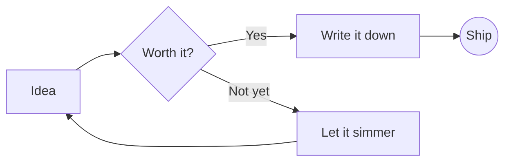
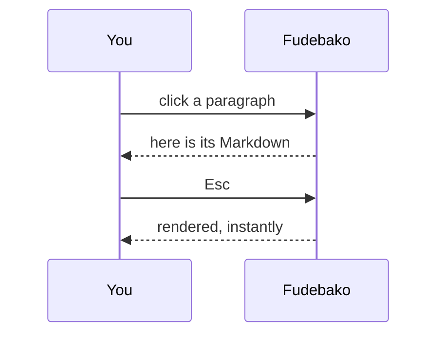

# Welcome to Fudebako

A featherweight Markdown editor where everything is *rendered* — and every block is one click away from its source. Its name, **筆箱** (*fudebako*), is Japanese for *pencil case*: a home for every pen, style and colour Markdown has to offer.

> [!TIP]
> **Click any paragraph, heading, list item or table row** to edit it as Markdown. Press <kbd>Esc</kbd> or click elsewhere to render it again. Use <kbd>↑</kbd> <kbd>↓</kbd> at the edge of a block to glide to its neighbours, and <kbd>Enter</kbd> twice to start a new block.

## Writing, beautifully

Text can be **bold**, *italic*, ~~struck~~, ==highlighted==, `inline code`, H~2~O or E = mc^2^. Links like [the CommonMark spec](https://commonmark.org) open with <kbd>Ctrl</kbd>-click. Emoji shortcodes work too :sparkles: :rocket:

- Lists continue automatically when you press Enter
- Press <kbd>Tab</kbd> to indent
  - like this nested item

Toggle tasks right in the rendered view:

- [x] Build a tiny editor
- [x] Render LaTeX and Mermaid
- [ ] Write something wonderful

## Mathematics

Inline math sits right in the sentence: $e^{i\pi} + 1 = 0$, or the golden ratio $\varphi = \frac{1+\sqrt5}{2}$.

$$
\int_{-\infty}^{\infty} e^{-x^2}\,dx = \sqrt{\pi}
\qquad
\sum_{n=1}^{\infty} \frac{1}{n^2} = \frac{\pi^2}{6}
$$

## Diagrams





## Code

```python
def fib(n: int) -> int:
    """Fast doubling Fibonacci."""
    a, b = 0, 1
    for bit in bin(n)[2:]:
        a, b = a * (2 * b - a), a * a + b * b
        if bit == "1":
            a, b = b, a + b
    return a
```

## Tables

| Extension        | Syntax              | Status |
| ---------------- | ------------------- | :----: |
| LaTeX (KaTeX)    | `$…$` and `$$…$$`   |   ✓    |
| Mermaid          | ` ```mermaid `      |   ✓    |
| Footnotes        | `[^1]`              |   ✓    |
| Alerts           | `> [!NOTE]`         |   ✓    |

## And the rest

> Simplicity is the ultimate sophistication.

Term
: A definition list, for glossaries and specs.

> [!WARNING]
> Fudebako saves a draft as you type, but **Ctrl+S** writes the real file.

Footnotes keep asides out of the way.[^1]

---

[^1]: Like this one. Click it to edit, too.
